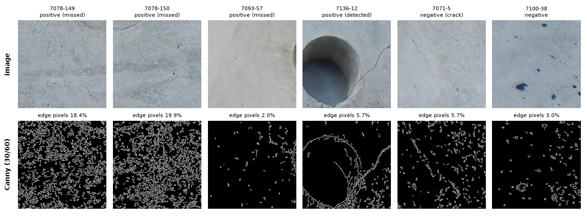
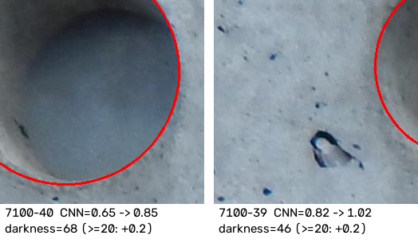
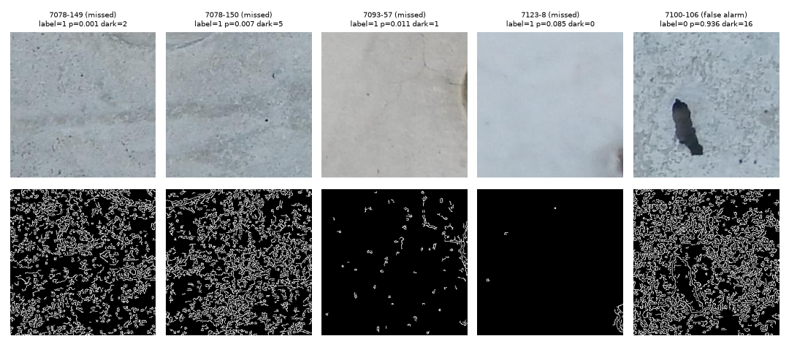

# Pコン跡検出（富士フイルム AI-FDE ハッカソン）

256×256 のコンクリート壁面画像（[SDNET2018](https://doi.org/10.15142/T3TD19)）に Pコン跡が含まれていれば 1、含まれていなければ 0 を出力する。
外部データ・事前学習済みの重みは使っていない（配布物と SDNET2018 のみ）。


## 結果

| 構成（上から順に工夫を追加） | 検証 F1 | public F1 |
|---|---|---|
| ベースライン：RGB 画像を入力とする CNN（データ拡張・陽性の比率調整なし、学習率一定） | 0.72 | 0.64 |
| ＋ 回転・反転による拡張、陽性の抽選比率の調整、学習率の cosine 減衰、TTA | 0.91 | 0.755 |
| ＋ ハフ変換による加点 | 0.93 | 0.805 |
| ＋ CNN の入力にエッジ画像を追加 | 0.93 | 0.8125 |
| **最終：エッジ画像入力 ＋ ハフ変換による加点（基準を厳しくした版）** | **0.94** | **0.8125** |

## 構成

```
train.py          学習。モデル（model.pt）と閾値（threshold.json）を outputs/model/ に保存
predict.py        評価用画像を予測し、提出ファイル outputs/submission.csv を作成
analyze.py        学習曲線と、検証画像の成功例・失敗例を並べた画像を作成（分析用）
valid_photos.csv  検証に使う元写真 8 枚の ID（残り 32 枚で学習する）
docs/             README に載せている図
```

- **入力**：RGB 画像 3 チャネル ＋ エッジ画像 1 チャネルの計 4 チャネル。エッジ画像は、グレースケールにした画像に Canny 法（しきい値 最小 30・最大 60）をかけ、明るさが急に変わる輪郭部分を白、それ以外を黒にした 2 値画像
- **モデル**：ResNet-18（torchvision、`weights=None` でランダム初期化）。最初の畳み込み層を 4 チャネル入力に変更。出力は「Pコン跡らしさ」の確率 1 つ
- **学習**：元写真 32 枚分（8,063 タイル）で 20 epoch。BCE 損失、AdamW（学習率 0.001、weight decay 0.0001）、学習率は cosine 減衰（コサインカーブに沿って 0 近くまで徐々に下げる）、バッチサイズ 64、混合精度
- **予測**：各画像を 90 度単位の回転 × 左右反転の有無で 8 通りの向きにして予測し、確率を平均する（TTA：Test Time Augmentation）
- **ハフ変換による加点**：円を検出するハフ変換（OpenCV）で、内側が周りよりはっきり暗い円（穴）が見つかった画像は、確率に +0.2 する
- **判定**：検証画像で F1 が最大になる閾値（0.16）以上を 1 とする

## 工夫した点

- Pコン跡は沈みひびわれの原因になりうるため、外観検査では Pコン跡の周辺が確認されている（問題文の補足、[参考文献 1](https://www.pref.tottori.lg.jp/secure/1021057/hibiwarema.pdf)・[2](https://www.cgr.mlit.go.jp/ctc/pdf/technology/concrete/a4-07.pdf)）。SDNET2018 でも、ひび割れのあるタイルの割合は陽性で 35%、陰性で 24% と約 1.5 倍だった
  ⇒ **ひび割れの線や穴の縁を浮かび上がらせるエッジ画像を、4 つ目の入力チャネルとして CNN に加えた**
- 陽性が 194 タイルしかない。Pコン跡は円形なので、向きが変わっても Pコン跡のまま
  ⇒ **90 度単位の回転・反転で 8 通りの見え方を作って学習し、予測時も 8 通りの平均を取った（TTA）**
- 陽性が全体の約 2% しかなく、バッチ 64 枚に平均 1 枚程度しか入らない
  ⇒ **学習時に陽性が約 1 割になるよう多めに抽選した**
- 学習率一定では epoch ごとに検証 F1 が大きく上下し、最後の epoch のモデルが安定しなかった
  ⇒ **学習率を cosine 減衰で徐々に下げた**
- RGB のみの CNN の誤判定を確認すると、穴がはっきり写っているのに確率が閾値にわずかに届かない見逃しがあった。[参考文献 3](http://data.jci-net.or.jp/data_pdf/37/037-01-1291.pdf) では Pコン跡の同定に円のハフ変換が使われている
  ⇒ **ハフ変換で穴らしい円が見つかった画像は、CNN の確率に +0.2 した**

### エッジ画像の入力



- Pコン跡の縁は円弧として、周りのひび割れは線として浮かび上がる（右から 3 番目の 7136-12）
- エッジの量（白い画素の割合）は、ひび割れのあるタイルで多い（10.1% と 8.7%）が、Pコン跡の有無では差がない（陽性 8.7%、陰性 9.1%）。表面のざらつきでもエッジが出るため（左の 7078-149 など）。手がかりは量ではなく形と位置であり、それを CNN に学習させる狙い

### ハフ変換による加点



- 画像の周りに余白を足して円を探し、画像の端で切れた弧も見つける
- 表面の模様から出る偽の円を除くため、「暗さ」（円のすぐ外側の平均の明るさ − 内側の平均の明るさ）が基準以上の円だけを穴とみなす
- 陽性の約 3 割は円が見つからないため、円がないときに確率を下げることはせず、上げるだけにした
- 基準はモデルに合わせて調整した。RGB のみの CNN では暗さ 20 以上（public 0.755 → 0.805）、エッジ画像入力ありでは 20〜40 だと加点が多すぎて public が下がったため、80 以上にした（検証 F1 0.93 → 0.94）

## 分析結果（最終構成）

### 学習曲線


序盤は検証スコアが大きく上下するが、学習率が下がるにつれて安定し、最後の epoch で検証 F1 0.93 となった。

### 最終構成でも失敗した画像



検証画像 2,016 タイル中、誤判定は 5 タイル（陽性 45 タイル中 41 を検出、誤検出 1）。p は CNN の確率、dark はハフ変換の暗さ。

| 画像 | 結果 | 様子 |
|---|---|---|
| 7078-149、7078-150、7093-57、7123-8 | 見逃し | Pコン跡の縁が画像の端や隅に数ピクセルだけ写っている |
| 7100-106 | 誤検出 | 表面の欠け（円ではない不定形の暗い穴） |

## 考察

- **残った見逃しは、Pコン跡の縁が画像の端にわずかに写っているだけのタイル。** 1 枚の画像には手がかりがほとんどなく、画像 1 枚ずつ判定する方式では原理的に難しい
- **エッジ画像の入力は、ひび割れとの関係という知見を CNN に渡す手段として有効だった**（public 0.805 → 0.8125）
- **ハフ変換は「見つかれば確実だが、見つからないことも多い」手がかり**なので加点のみに使った。最適な基準はモデルごとに変わる
- **誤検出の欠けは、穴が円かどうかで区別できる余地がある**（暗い穴があるのに円ではない画像の確率を下げる処理）

## 参考文献

1. 鳥取県「[コンクリート構造物ひび割れ抑制対策マニュアル（案）](https://www.pref.tottori.lg.jp/secure/1021057/hibiwarema.pdf)」2016
2. 中国地方整備局「[コンクリート構造物の品質確保・向上の手引き（案）【施工編（監督・検査）】](https://www.cgr.mlit.go.jp/ctc/pdf/technology/concrete/a4-07.pdf)」2022
3. 全ら「[画像解析によるひび割れ検出とハフ変換による型枠跡および Pコン跡の同定](http://data.jci-net.or.jp/data_pdf/37/037-01-1291.pdf)」コンクリート工学年次論文集, 2015
- データセット：Maguire, M., Dorafshan, S., & Thomas, R. J. (2018). [SDNET2018: A concrete crack image dataset for machine learning applications](https://doi.org/10.15142/T3TD19). Utah State University.（[CC BY 4.0](https://creativecommons.org/licenses/by/4.0/)）

`docs/` の図に含まれる画像は SDNET2018 の画像を加工（並べ替え・エッジ処理・検出した円の描画・文字の追記）したもの。SDNET2018 は [CC BY 4.0](https://creativecommons.org/licenses/by/4.0/) で公開されている。

## 実行環境

- Windows 11、NVIDIA GeForce RTX 4050 Laptop GPU（6GB）
- Python 3.13、PyTorch 2.11（CUDA 12.8）
- 学習 約 20 分、予測 約 7 分（うちハフ変換が約 6 分。ハフ変換の結果は outputs/hough_darkness.csv に保存され、2 回目以降の予測は約 1 分）

## 再現手順

### 1. データを配置する

配布物と SDNET2018 を次のように置く（画像パスは `train_label.csv` / `test.txt` に書かれた相対パスと一致させる）。

```
data/
  train_label.csv
  test.txt
  SDNET2018/
    W/
      CW/7069-3.jpg ...
      UW/7069-1.jpg ...
```

### 2. 環境を作る

```powershell
python -m venv .venv
.\.venv\Scripts\python.exe -m pip install torch torchvision --index-url https://download.pytorch.org/whl/cu128
.\.venv\Scripts\python.exe -m pip install -r requirements.txt
```

### 3. 学習する

```powershell
.\.venv\Scripts\python.exe train.py
```

`outputs/model/` に `model.pt`（モデルの重み）、`threshold.json`（閾値と検証スコア）、`history.csv`（epoch ごとの損失と検証スコア）、`valid_predictions.csv`（検証画像ごとの予測確率）が保存される。

### 4. 予測して提出ファイルを作る

```powershell
.\.venv\Scripts\python.exe predict.py
```

`outputs/submission.csv`（`<相対パス>,<0|1>`、ヘッダなし、`test.txt` と同じ順序）が作られる。

### 5. 分析画像を作る（任意）

```powershell
.\.venv\Scripts\python.exe analyze.py
```

`outputs/model/` に学習曲線（`learning_curve.png`）と成功例・失敗例の画像（`analysis.png`）が作られる。

乱数のシードと、計算結果が毎回同じになる設定（決定的アルゴリズム）を固定しているため、同じ GPU・同じライブラリのバージョンなら同じ結果になる。

## 用語

- **元写真・タイル**：SDNET2018 の画像は、壁を撮った元写真 1 枚を 256×256 に切り分けたもの（タイル）。学習用は元写真 40 枚（10,079 タイル）、評価用は別の元写真 32 枚（8,059 タイル）から作られている
- **陽性・陰性**：Pコン跡が含まれるタイル（正解 1）を陽性、含まれないタイル（正解 0）を陰性と呼ぶ。学習用の陽性は 194 タイル（約 2%）
- **検証 F1**：学習に使っていない元写真 8 枚（2,016 タイル、陽性 45 タイル）で測った F1 スコア
- **public F1**：コンペのサイトに提出して表示された F1 スコア（評価用画像の一部で計算される）
- **閾値**：モデルが出す「Pコン跡らしさ」の確率がこの値以上なら 1 と判定する