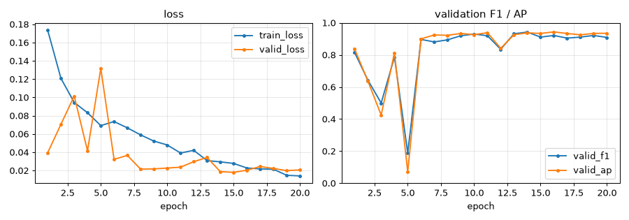

# Pコン跡検出（富士フイルム AI-FDE ハッカソン）

256×256 のコンクリート壁面画像（SDNET2018）に Pコン跡が含まれていれば 1、含まれていなければ 0 を出力する。
外部データ・事前学習済みの重みは使っていない（配布物と SDNET2018 のみ）。

| | 検証 F1 | 検証 AP | public F1 |
|---|---|---|---|
| ベースライン（拡張・比率調整なし、学習率一定） | 0.72 | 0.76 | 0.64 |
| **最終モデル** | **0.91** | **0.93** | **0.755** |

検証は学習用の元写真のうち 8 枚（陽性 45 タイル）で行った。

## 構成

```
train.py    学習。モデル（model.pt）と閾値（threshold.json）を outputs/model/ に保存
predict.py  評価用画像を予測し、提出ファイル outputs/submission.csv を作成
analyze.py  学習曲線と、検証画像の成功例・失敗例を並べた画像を作成（分析用）
docs/       README に載せている図
folds.csv   元写真ごとの分割番号（fold 0 の 8 枚を検証に使う）
```

- **モデル**：ResNet-18（torchvision、`weights=None` でランダム初期化）。出力は Pコン跡らしさのスコア 1 つ
- **学習**：元写真 32 枚分（8,063 タイル）で 20 epoch。BCE 損失、AdamW（学習率 0.001、weight decay 0.0001）、cosine で学習率を減衰、バッチサイズ 64、混合精度
- **判定**：検証画像で F1 が最大になる閾値（0.84）以上を 1 とする
- **予測**：90 度単位の回転 × 反転の 8 通りで予測して平均（TTA）

## 工夫した点

- 陽性（Pコン跡あり）が 194 枚しかない。Pコン跡は円形で、向きが変わっても Pコン跡のまま
  ⇒ **90 度単位の回転・反転で 1 枚から 8 通りの見え方を作って学習し、予測時も 8 通りの平均を取った（TTA）**
- 陽性が全体の約 2% しかなく、バッチ 64 枚に平均 1 枚程度しか入らない
  ⇒ **学習時に陽性が約 1 割になるよう重み付きで抽選した**
- 学習率一定ではエポックごとに検証スコアが大きく揺れ、最終モデルが安定しなかった
  ⇒ **学習率を cosine で徐々に下げた**

## 学習の様子と分析結果

### 学習曲線



学習率が高い序盤（〜5 epoch）は検証スコアが大きく揺れるが、cosine で学習率が下がるにつれて安定し、6 epoch 以降は検証 F1 / AP とも 0.9 前後で推移した。

### 成功例・失敗例（検証画像、閾値 0.84）


上から、検出できた陽性（TP 40 枚）、見逃した陽性（FN 5 枚）、誤検出（FP 3 枚）、閾値に近かった陰性。

- 穴がはっきり写った Pコン跡に加え、モルタルで埋め戻された Pコン跡（7123-9、7123-34）も検出できている
- 見逃しの多くは、Pコン跡の縁が画像の端に数ピクセルだけ写ったタイル（7093-57、7078-149、7078-150）
- 誤検出は、画像の端にかかった黒い汚れ（7123-1、7123-228）や、表面の欠け（7100-227）

## 実行環境

- Windows 11、NVIDIA GeForce RTX 4050 Laptop GPU（6GB）
- Python 3.13、PyTorch 2.11（CUDA 12.8）
- 学習 約 20 分、予測 約 1 分

## 再現手順

### 1. データを配置する

配布物と SDNET2018 を次のように置く（画像パスは `train_label.csv` / `test.txt` の相対パスと一致させる）。

```
data/
  train_label.csv
  test.txt
  SDNET2018/
    W/
      CW/7069-3.jpg ...
      UW/7069-1.jpg ...
```

### 2. 環境を作る

```powershell
python -m venv .venv
.\.venv\Scripts\python.exe -m pip install torch torchvision --index-url https://download.pytorch.org/whl/cu128
.\.venv\Scripts\python.exe -m pip install -r requirements.txt
```

### 3. 学習する

```powershell
.\.venv\Scripts\python.exe train.py
```

`outputs/model/` に `model.pt`（重み）、`threshold.json`（閾値と検証スコア）、`history.csv`（エポックごとの損失と検証スコア）、`valid_predictions.csv`（検証画像の予測）が保存される。

### 4. 予測して提出ファイルを作る

```powershell
.\.venv\Scripts\python.exe predict.py
```

`outputs/submission.csv`（`<相対パス>,<0|1>`、ヘッダなし、`test.txt` と同じ順序）が作られる。

### 5. 分析画像を作る（任意）

```powershell
.\.venv\Scripts\python.exe analyze.py
```

`outputs/model/` に学習曲線（`learning_curve.png`）と成功例・失敗例の画像（`analysis.png`）が作られる。
