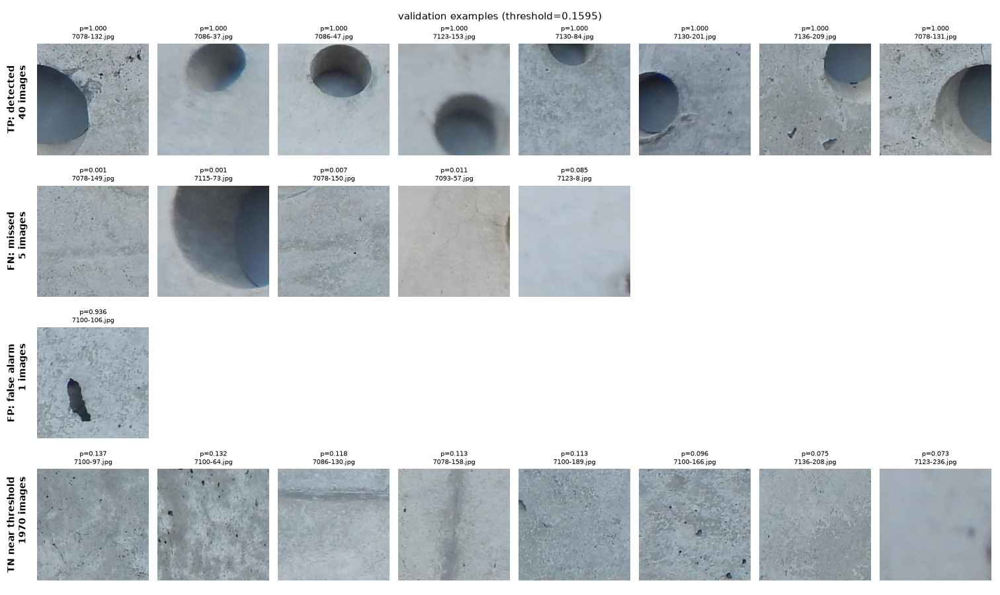

# Pコン跡検出（富士フイルム AI-FDE ハッカソン）

256×256 のコンクリート壁面画像（SDNET2018）に Pコン跡が含まれていれば 1、含まれていなければ 0 を出力する。
外部データ・事前学習済みの重みは使っていない（配布物と SDNET2018 のみ）。

| | 検証 F1 | public F1 |
|---|---|---|
| ベースライン（拡張・比率調整なし、学習率一定） | 0.72 | 0.64 |
| CNN（回転・反転、陽性の抽選比率調整、cosine、TTA） | 0.91 | 0.755 |
| CNN ＋ ハフ変換による加点 | 0.93 | 0.805 |
| **最終：CNN の入力にエッジ画像を追加** | **0.93** | **0.8125** |

検証は学習用の元写真のうち 8 枚（陽性 45 タイル）で行った。

## 構成

```
train.py          学習。モデル（model.pt）と閾値（threshold.json）を outputs/model/ に保存
predict.py        評価用画像を予測し、提出ファイル outputs/submission.csv を作成
analyze.py        学習曲線と、検証画像の成功例・失敗例を並べた画像を作成（分析用）
valid_photos.csv  検証に使う元写真 8 枚の ID（残り 32 枚で学習する）
docs/             README に載せている図
```

- **入力**：RGB 画像 ＋ Canny（最小 30・最大 60）によるエッジの 2 値画像の 4 チャネル
- **モデル**：ResNet-18（torchvision、`weights=None` でランダム初期化、最初の畳み込みを 4 チャネル入力に変更）。出力は Pコン跡らしさのスコア 1 つ
- **学習**：元写真 32 枚分（8,063 タイル）で 20 epoch。BCE 損失、AdamW（学習率 0.001、weight decay 0.0001）、cosine で学習率を減衰、バッチサイズ 64、混合精度
- **予測**：90 度単位の回転 × 反転の 8 通りで予測して平均（TTA）
- **判定**：検証画像で F1 が最大になる閾値（0.16）以上を 1 とする

## 工夫した点

- 陽性（Pコン跡あり）が 194 枚しかない。Pコン跡は円形で、向きが変わっても Pコン跡のまま
  ⇒ **90 度単位の回転・反転で 8 通りの見え方を作って学習し、予測時も 8 通りの平均を取った（TTA）**
- 陽性が全体の約 2% しかなく、バッチ 64 枚に平均 1 枚程度しか入らない
  ⇒ **学習時に陽性が約 1 割になるよう重み付きで抽選した**
- 学習率一定では epoch ごとに検証スコアが大きく揺れ、最終モデルが安定しなかった
  ⇒ **学習率を cosine で徐々に下げた**
- Pコン跡は沈みひびわれの原因になりうるため、外観検査では Pコン跡の周辺が確認されている（問題文の補足、[参考文献 1](https://www.pref.tottori.lg.jp/secure/1021057/hibiwarema.pdf)・[2](https://www.cgr.mlit.go.jp/ctc/pdf/technology/concrete/a4-07.pdf)）。つまり Pコン跡の近くにはひび割れが出やすい。実際、SDNET2018 のひび割れラベルでも、ひびありのタイルの割合は Pコン跡ありで 35%、なしで 24% と約 1.5 倍だった。エッジ画像はひび割れの線や穴の縁を浮かび上がらせるため、手がかりになると考えた
  ⇒ **Canny のエッジの 2 値画像を、RGB に続く 4 つ目の入力チャネルとして加えた**

### エッジ画像の入力


- 7136-12 のように、Pコン跡の縁は円弧として、周りのひび割れは線として、はっきり浮かび上がる
- エッジの画素の割合は、ひびありのタイル 10.1%、ひびなし 8.7% と、ひび割れに反応している
- 一方、Pコン跡あり 8.7%、なし 9.1% とエッジの量に差はない（表面のざらつきでもエッジが多く出るため。7078-149、7078-150 など）。手がかりは量ではなく、円弧や線の形と位置で、それを CNN に学習させる狙い

### ハフ変換による加点（RGB のみのモデルで有効、最終構成では不使用）

誤り分析で、穴がはっきり写っているのに CNN の確率が閾値にあと一歩届かず見逃している画像（7100-40、7100-39）が見つかった。[参考文献 3](http://data.jci-net.or.jp/data_pdf/37/037-01-1291.pdf) では Pコン跡の同定に円のハフ変換が使われているため、ハフ変換で「内側が暗い円（穴）」が見つかった画像は CNN の確率に +0.2 することにした。


- 画像の周りに余白を足してから円を探し、中心が画像の外にある円（端で切れた弧）も見つける
- 「円の外側の輪の明るさ − 内側の明るさ」が 20 以上の円だけを穴とみなし、表面の模様から出るニセの円を除く
- 円が見つからないことは陰性の根拠として弱い（陽性の 3 割は円が見えない）ため、加点だけにした
- RGB のみのモデルでは public F1 が 0.755 → 0.805 に上がった。エッジ入力ありのモデルでは逆に下がった（0.8125 → 0.788）ため、最終構成では使っていない（`predict.py --hough-bonus 0.2` で有効になる）

## 学習の様子と分析結果（最終モデル）

### 学習曲線


序盤（〜5 epoch）は学習率が高く検証スコアが大きく揺れるが、cosine で学習率が下がるにつれて安定し、最終 epoch で検証 F1 0.93、AP 0.93 となった。

### 成功例・失敗例（検証画像、閾値 0.16）



上から、検出できた陽性（TP 40 枚）、見逃した陽性（FN 5 枚）、誤検出（FP 1 枚）、閾値に近かった陰性。

- 見逃しの多くは、Pコン跡の縁が画像の端に数ピクセルだけ写ったタイル（7078-149、7078-150、7093-57）
- 誤検出は表面の欠け（7100-106）の 1 枚だけ

## 参考文献

1. 鳥取県「[コンクリート構造物ひび割れ抑制対策マニュアル（案）](https://www.pref.tottori.lg.jp/secure/1021057/hibiwarema.pdf)」2016
2. 中国地方整備局「[コンクリート構造物の品質確保・向上の手引き（案）【施工編（監督・検査）】](https://www.cgr.mlit.go.jp/ctc/pdf/technology/concrete/a4-07.pdf)」2022
3. 全ら「[画像解析によるひび割れ検出とハフ変換による型枠跡および Pコン跡の同定](http://data.jci-net.or.jp/data_pdf/37/037-01-1291.pdf)」コンクリート工学年次論文集, 2015

## 実行環境

- Windows 11、NVIDIA GeForce RTX 4050 Laptop GPU（6GB）
- Python 3.13、PyTorch 2.11（CUDA 12.8）
- 学習 約 20 分、予測 約 1 分

## 再現手順

### 1. データを配置する

配布物と SDNET2018 を次のように置く（画像パスは `train_label.csv` / `test.txt` の相対パスと一致させる）。

```
data/
  train_label.csv
  test.txt
  SDNET2018/
    W/
      CW/7069-3.jpg ...
      UW/7069-1.jpg ...
```

### 2. 環境を作る

```powershell
python -m venv .venv
.\.venv\Scripts\python.exe -m pip install torch torchvision --index-url https://download.pytorch.org/whl/cu128
.\.venv\Scripts\python.exe -m pip install -r requirements.txt
```

### 3. 学習する

```powershell
.\.venv\Scripts\python.exe train.py
```

`outputs/model/` に `model.pt`（重み）、`threshold.json`（閾値と検証スコア）、`history.csv`（epoch ごとの損失と検証スコア）、`valid_predictions.csv`（検証画像の予測）が保存される。

### 4. 予測して提出ファイルを作る

```powershell
.\.venv\Scripts\python.exe predict.py
```

`outputs/submission.csv`（`<相対パス>,<0|1>`、ヘッダなし、`test.txt` と同じ順序）が作られる。

### 5. 分析画像を作る（任意）

```powershell
.\.venv\Scripts\python.exe analyze.py
```

`outputs/model/` に学習曲線（`learning_curve.png`）と成功例・失敗例の画像（`analysis.png`）が作られる。

乱数シードと決定的アルゴリズムを固定しているため、同じ GPU・同じライブラリのバージョンなら同じ結果になる。
